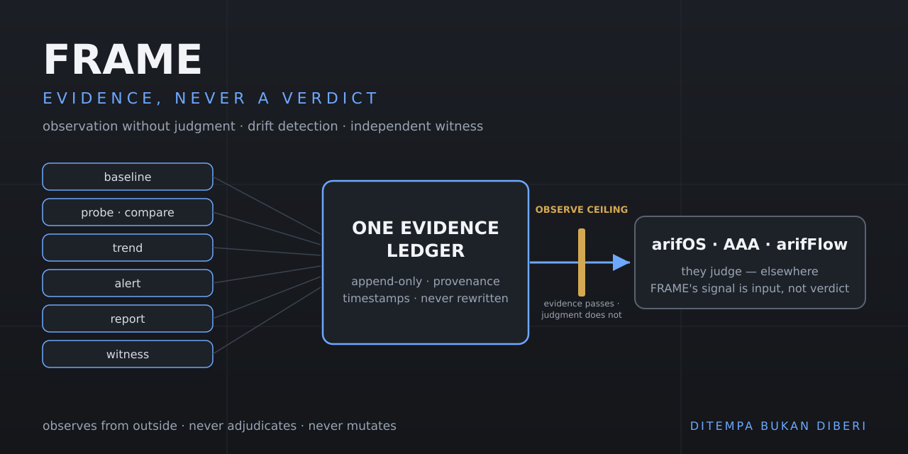

<!-- SOT-MANIFEST
federation_release: v2026.09.13
last_verified: 2026-09-13T06:32:00Z
live_commit: f9ade12
live_health: ok :18085 observer (chambers active) — FRAME evaluates contrast, never mutates A2A terminal states
apex_zen: A2A delegates ⊥ MCP equips ⊥ ACT mutates ⊥ arifOS governs ⊥ F13 decides
organ: FRAME
role: substrate-organ (frame-organ.service — capability substrate)
authority: OBSERVE_ONLY — provides substrate primitives, never adjudicates
license: AGPL-3.0
truth_rule: live systemctl status frame-organ.service + /health endpoint beat any static count in prose
-->

> ### ⚠️ Archive mirror — read before using
> **This GitHub repo is the read-only mirror of FRAME.** Canonical source: [`ariffazil/AAA`](https://github.com/ariffazil/AAA) → `federation/frame/` (organs.yaml, 2026-10-14) · migration: [`AAA_FEDERATION_FRAME_BOUNDARY_ALIGNMENT.md`](https://github.com/ariffazil/AAA/blob/main/federation/AAA_FEDERATION_FRAME_BOUNDARY_ALIGNMENT.md) (consolidated 2026-08-26).
> The **live service never left**: `frame-organ.service` on `:18085`, deployed at `/opt/frame/app`, identity preserved (unit, port, license, chambers).
> One post-archive exception: commit `ed5f9e4` (2026-10-15) rescued deployed-only code from `/opt/frame` to close a single-point-of-loss gap.

<p align="center"></p>

# FRAME

**Observe. Record. Witness.**

FRAME is the independent observer of the arifOS federation: it baselines every organ, probes runtime state, detects drift and trends, and writes the findings into one evidence surface. *Measurement without a reference frame is just numbers.*

[](#role-invariant)
[](http://127.0.0.1:18085/health)
[](#role-invariant)
[](./LICENSE)

> ### Role invariant
> **Its output is evidence, never a verdict.** FRAME observes from outside and reports; it never adjudicates, never executes, never mutates, never rewrites VAULT999 (it reads the seal head only).
> It is a **boundary service, not a constitutional organ** — judgment belongs to [arifOS](https://github.com/ariffazil/arifOS), execution to [A-FORGE](https://github.com/ariffazil/A-FORGE).
> *Authority ceiling drift, stated honestly:* organs.yaml records `ADVISORY_ONLY`, this repo's manifest records `OBSERVE_ONLY` — unresolved between SOTs; both ceilings forbid adjudication and execution, which is what the invariant above protects.

## What works today
*(all claims measured 2026-10-16 unless dated otherwise)*

- **Live observer at `:18085`** — `/health` reports `status: ok`, version 1.0.0, **9/9 chambers active** (baseline · probe · compare · trend · alert · report · rsi_verify · rejection · witness).
- **Institutional baseline** covering 10 organs, established 2026-08-06T09:57:02Z, still the reference frame for drift comparison.
- **Drift endpoints live** — `/frame/baseline`, `/frame/probe`, `/frame/drift`, `/frame/trend`, `/frame/alert`, `/frame/report` (organs.yaml interface map).
- **Deployed-reality parity** — 2026-10-15 commits imported deployed-only code from `/opt/frame` (`ed5f9e4`) and synced `frame-organ.service` with what actually runs (`2c862e3`).
- **CI governance** — Dependabot `uv` ecosystem + `uv lock --check` invariant workflow + constitutional-package denylist on auto-merge (F13 verdict 2026-08-10).

## What is not yet proven

- **Authority ceiling is contested** (`ADVISORY_ONLY` vs `OBSERVE_ONLY`) — see the invariant block. Until one SOT wins, treat the stricter ceiling as binding.
- **Drift-detection accuracy** — no measured false-positive / false-negative rate for the compare chamber; no independent audit of the evidence it emits.
- **Chamber census drift** — organs.yaml documents 6 chambers; the live endpoint serves 9. The endpoint wins here, but the registry has not been reconciled (2026-10-16).
- **No public MCP wire from `:18085`** — organs.yaml notes the MCP surface is `:18086/mcp` while `:18085` serves `/health` only. `:18086` was MCP-OK at the 2026-10-14 audit; not re-proven today.

## 30-second proof

```bash
curl -s http://127.0.0.1:18085/health
```

Observed output (abridged, 2026-10-16T08:50:16Z):

```json
{"status":"ok","organ":"frame","port":18085,"version":"1.0.0",
 "baseline_organs":10,"baseline_established":"2026-08-06T09:57:02Z",
 "chambers":{"baseline":"active","probe":"active","compare":"active","trend":"active","alert":"active","report":"active","rsi_verify":"active","rejection":"active","witness":"active"}}
```

Read-only. Operator surfaces: `make health` · `make probe` · `systemctl status frame-organ.service`.

## What FRAME does (four jobs)

1. **Baseline** — hold the reference frame: expected state of every organ (`/frame/baseline`).
2. **Probe & compare** — read live runtime state and diff it against baseline (`/frame/probe`, `/frame/drift`).
3. **Trend & alert** — track drift over time and cross thresholds (`/frame/trend`, `/frame/alert`).
4. **Report & witness** — emit period reports and independent witness records (`/frame/report`); the witness path is separation of powers — FRAME observes from outside while arifOS adjudicates.

## Current verified state

**Observed at 2026-10-16T08:50:16Z** — method: `curl -s http://127.0.0.1:18085/health` (runtime self-report; not an independent audit).

| Fact | Value |
|---|---|
| Status | `ok` · `frame-organ.service` · version 1.0.0 |
| Chambers | 9/9 active (incl. rsi_verify, rejection, witness — beyond the 6 in organs.yaml) |
| Baseline | 10 organs · established 2026-08-06T09:57:02Z |
| Mutations performed | 0 — observe ceiling; evidence only |

Dynamic state is generated by probe. **If this section conflicts with the live endpoint, the endpoint wins.**

## Development

- **Runtime:** `/opt/frame/app` under `frame-organ.service` (Python 3.13, package `frame_organ`). Canonical source: [`ariffazil/AAA`](https://github.com/ariffazil/AAA) `federation/frame/`.
- **Operator surface:** `Makefile` — `install` · `deploy` · `health` · `probe` · `clean`.
- **Logs:** `journalctl -u frame-organ.service`.
- **CI:** `.github/workflows/` — `dependabot-ci.yml`, `ci-uv-lock-invariant.yml`, `auto-merge-dependabot.yml` (F13 review the only merge path for constitutional packages).

## License & federation identity

GNU AGPL-3.0 — arifOS Federation. Sovereign: **Muhammad Arif bin Fazil** (F13 SOVEREIGN). *DITEMPA BUKAN DIBERI — Truth must cool before it rules.*

<!-- FEDERATION-STANDARD v2026-10-15 START :: 333-AGI audit :: source: organs.yaml + git + live probes :: regenerate: re-run audit -->
## 🔗 Federation Identity (auto-audit 2026-10-15)
| Field | Value |
|---|---|
| Organ | `frame` · CORE · federation_measurement |
| Ports | 18085 |
| Unit | frame-organ.service |
| Authority ceiling | ADVISORY_ONLY |
| Live (SOT probe @audit) | UP |
| Repo HEAD @audit | `2c862e3 2026-10-07` |
| Public MCP | — |
| Rollback | — |
| Flow graph | `/root/FEDERATION-FLOW-GRAPH.md` (on-box federation map — outside this repo; relative link removed 2026-10-16) |
<!-- FEDERATION-STANDARD v2026-10-15 END -->
